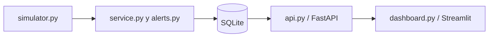

# Arquitectura de RoboTelemetry Lite

## Objetivo y límites

Telemetría simulada local de un robot móvil para aprender simulación, persistencia, API y visualización. Python 3.12+, FastAPI/Uvicorn, Pydantic 2, SQLite, httpx, pandas y Streamlit; las dependencias y rangos reales están en `pyproject.toml`. No hay control de hardware ni infraestructura cloud.

## Puntos de entrada y responsabilidades

| Archivo | Responsabilidad |
| --- | --- |
| `src/robotelemetry/simulator.py` | CLI, generador reproducible y bucle de adquisición; cinco escenarios |
| `models.py`, `config.py` en el mismo paquete | Contratos Pydantic, unidades, escenarios y configuración validada |
| `alerts.py`, `service.py` | Reglas por lectura e ingesta; alertas y medición en una operación |
| `storage.py` | Esquema, índices, consultas y transacción SQLite |
| `api.py` | `create_app(settings)`, lifespan y endpoints de consulta |
| `dashboard.py` en la raíz | Entrada Streamlit; delega en `src/robotelemetry/dashboard.py` |
| `scripts/prepare_demo.py` | Lote determinista en una base nueva; no sobrescribe bases existentes |
| `scripts/smoke_check.py` | Procesos locales, persistencia y Streamlit AppTest sobre datos temporales |

Simulador, API y dashboard son procesos independientes. La API no inicia el simulador. La vista consulta HTTP, no SQLite directamente. Su pausa detiene el refresco, no la adquisición.

## Datos y API

`measurements` tiene unicidad `(run_id, sequence)`; `alerts` referencia la medición y limita a una alerta de cada tipo por medición. Se usan claves foráneas, WAL y conexiones cortas; medición y alertas se confirman o revierten juntas. Fechas conscientes de zona se normalizan a UTC. No hay migraciones versionadas, retención ni backups automáticos.

`GET /health` devuelve estado y contadores; `/config`, umbrales; `/telemetry/latest`, última lectura (404 si está vacío); `/telemetry/history`, paginación y filtros temporales; `/alerts`, paginación y filtro por tipo. `/docs` expone el contrato OpenAPI. Las consultas paginadas admiten como máximo 1000 registros por petición. El CSV del dashboard corresponde a su ventana seleccionada.

## Configuración y decisiones que conservar

- `ROBO_DB_PATH` se ancla a la raíz del proyecto si es relativo. API y simulador deben compartir base y umbrales.
- Umbrales: `ROBO_BATTERY_LOW_PCT=20`, `ROBO_TEMPERATURE_HIGH_C=65`, `ROBO_OBSTACLE_NEAR_M=0.5`. Cambiarlos no recalcula alertas antiguas.
- `ROBO_API_URL` selecciona la API del dashboard. No hay carga implícita de `.env`; cada terminal requiere sus variables.
- La semilla controla valores simulados; `run_id` y hora real no deben confundirse con igualdad binaria entre ejecuciones. `--interval 0` requiere un lote finito con `--samples`.
- Las alertas son ocurrencias por lectura, no incidentes con estados abierto/cerrado. La API carece de autenticación y está pensada para localhost.

Instalación, los tres procesos y sus puertos: [README](README.md). Alcance de comprobaciones y posibles evoluciones: [estado](PROJECT_STATUS.md).
