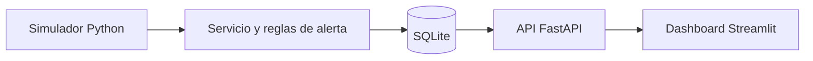
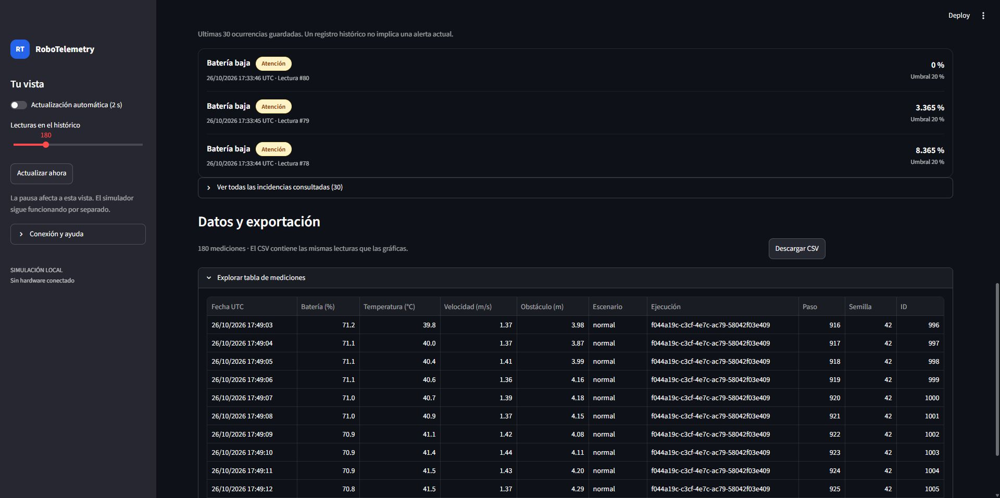

# RoboTelemetry Lite

Proyecto personal de portfolio universitario para **simular y monitorizar la telemetría de un robot móvil**. Genera lecturas en Python, las guarda en SQLite, las consulta mediante una API FastAPI y las muestra en un dashboard Streamlit.

**Los sensores y los datos son simulados.** No hay conexión con un robot físico ni integración actual con ABB RobotStudio, FANUC ROBOGUIDE o AWS. Todo funciona en local, sin cuentas externas ni servicios de pago.

## Funcionalidades

- **Simulación:** batería, temperatura, velocidad y distancia al obstáculo más cercano, con semilla reproducible y cinco escenarios: normal, low_battery, overheating, obstacle y demo.
- **Alertas:** detección de batería baja, temperatura elevada y obstáculos próximos. Cada incumplimiento se registra por lectura; no se gestionan incidentes abiertos o cerrados.
- **Histórico:** almacenamiento de mediciones y alertas en SQLite, con consultas REST, paginación y filtros.
- **Gráficas:** dashboard con estado actual, alertas, histórico y cuatro gráficas temporales en UTC.
- **CSV:** exportación de las mediciones de la ventana seleccionada en el dashboard, no de toda la base de datos.

## Tecnologías

| Tecnología | Uso |
| --- | --- |
| Python 3.12+ | Simulación y lógica del proyecto |
| FastAPI | API REST de consulta |
| SQLite | Persistencia local |
| Streamlit | Dashboard y visualización |
| Pydantic | Modelos y validación de datos |
| Pytest | Pruebas automatizadas |

Las dependencias completas están en [pyproject.toml](pyproject.toml).

## Arquitectura



El simulador escribe las lecturas y sus alertas en SQLite. FastAPI consulta esa base y Streamlit obtiene los datos a través de HTTP. **Simulador, API y dashboard son procesos independientes**: cerrar la interfaz no detiene la simulación ni borra el histórico.

## Capturas

Capturas reales del dashboard, obtenidas con **datos simulados** el 26 de octubre de 2026:

**Estado y alertas**


**Histórico e incidencias**



**Gráficas**


Las capturas son anteriores al ajuste del formato de ejes para ventanas de varios días. Ese comportamiento tiene pruebas automatizadas, pero su **revisión visual final en navegador sigue pendiente**, al igual que la confirmación visual de controles y descarga CSV.

## Instalación y ejecución

En **Windows PowerShell**, con Python 3.12 o superior y conexión a Internet para instalar dependencias. Ejecuta los comandos desde la **raíz del repositorio**. SQLite ya viene incluido en Python y no hace falta activar el entorno virtual ni cambiar ExecutionPolicy.

**1. Instalar**

```powershell
py --list
py -3.12 -m venv .venv
.\.venv\Scripts\python.exe --version
.\.venv\Scripts\python.exe -m pip install --upgrade pip
.\.venv\Scripts\python.exe -m pip install -e '.[dev]'
.\.venv\Scripts\python.exe -m pip check
```

Si tienes Python 3.14 en vez de 3.12, usa **py -3.14 -m venv .venv** en la segunda línea; los demás comandos no cambian.

**2. Crear datos de demostración**

```powershell
.\.venv\Scripts\python.exe scripts\prepare_demo.py --output data/demo-v1.sqlite3 --seed 42
```

Genera **140 lecturas y 34 alertas** con los umbrales predeterminados (20 % de batería, 65 °C y 0,5 m). **La herramienta exige una base nueva: no sobrescribe archivos existentes.** Si data/demo-v1.sqlite3 ya existe, elige otro nombre de archivo y usa esa misma ruta en las terminales siguientes. La demo no toma su ruta de ROBO_DB_PATH.

**3. Arrancar la API — terminal 1**

```powershell
$env:ROBO_DB_PATH = 'data/demo-v1.sqlite3'
$env:ROBO_BATTERY_LOW_PCT = '20'
$env:ROBO_TEMPERATURE_HIGH_C = '65'
$env:ROBO_OBSTACLE_NEAR_M = '0.5'
.\.venv\Scripts\python.exe -m uvicorn robotelemetry.api:app --host 127.0.0.1 --port 8000
```

Deja el proceso abierto. Documentación de la API: [http://127.0.0.1:8000/docs](http://127.0.0.1:8000/docs).

**4. Abrir el dashboard — terminal 2**

```powershell
$env:ROBO_API_URL = 'http://127.0.0.1:8000'
.\.venv\Scripts\python.exe -m streamlit run dashboard.py --server.address 127.0.0.1 --server.port 8501 --browser.gatherUsageStats false
```

Abre [http://127.0.0.1:8501](http://127.0.0.1:8501). La demo ya permite consultar el histórico; si aparece un aviso de datos antiguos es porque el lote simulado terminó.

**5. Añadir telemetría en directo — terminal 3 (opcional)**

```powershell
$env:ROBO_DB_PATH = 'data/demo-v1.sqlite3'
$env:ROBO_BATTERY_LOW_PCT = '20'
$env:ROBO_TEMPERATURE_HIGH_C = '65'
$env:ROBO_OBSTACLE_NEAR_M = '0.5'
.\.venv\Scripts\python.exe -m robotelemetry.simulator --seed 42 --scenario normal
```

Se añade una lectura aproximadamente cada segundo hasta pulsar **Ctrl+C**. Para simular anomalías, detén ese proceso y repite el comando con **--scenario demo**. La pausa del dashboard solo detiene el refresco de la vista; no detiene el simulador.

**Importante:** las variables de entorno de PowerShell no se comparten automáticamente entre terminales. API y simulador deben usar **la misma base y los mismos umbrales**. Los umbrales nuevos no recalculan alertas anteriores. Los procesos se detienen con **Ctrl+C** y los datos permanecen en SQLite. Si cambias el puerto de la API, actualiza también ROBO_API_URL. Los archivos .env no se cargan automáticamente.

Esta aplicación está pensada para **localhost**, sin autenticación ni copias de seguridad o retención automáticas. No debe exponerse públicamente sin medidas adicionales ni considerarse un sistema de producción o control de robots.

Guía ampliada: [docs/DEMO.md](docs/DEMO.md).

## Pruebas

Desde la raíz, con el entorno instalado:

```powershell
.\.venv\Scripts\python.exe -m pytest --cov=robotelemetry --cov-report=term-missing
.\.venv\Scripts\python.exe scripts\smoke_check.py
.\.venv\Scripts\python.exe -m pip check
```

**Estado actual de main:** 187 pruebas aprobadas y **99,30 % de cobertura combinada local** (Windows, Python 3.14.7, 2 de noviembre de 2026). Pytest muestra el resultado redondeado como 99 %. La [ejecución de GitHub Actions de main](https://github.com/EduardoManzanoAlcaraz/robotelemetry-lite/actions/runs/41474386312) terminó correctamente con **187 pruebas en cada uno de cuatro entornos**: Windows y Ubuntu, con Python 3.12 y 3.14, además de pip check y el smoke check.

**Release histórica [v1.0.0](https://github.com/EduardoManzanoAlcaraz/robotelemetry-lite/releases/tag/v1.0.0):** 161 pruebas y 94 % de cobertura. Esa release y su tag permanecen intactos; la ampliación de pruebas está en main. Las cifras locales no deben confundirse con los resultados de CI.

El smoke check verifica procesos, API, persistencia y ejecución del dashboard con AppTest, **no una inspección visual del navegador**. Detalles y limitaciones: [docs/VERIFICACION.md](docs/VERIFICACION.md). También puedes consultar el [workflow](.github/workflows/tests.yml), el [historial de cambios](CHANGELOG.md) y la [presentación para portfolio](docs/PORTFOLIO.md).

## Posibles mejoras

- Integrar un simulador industrial como **ABB RobotStudio** o **FANUC ROBOGUIDE** para sustituir las lecturas sintéticas por datos procedentes de un entorno de simulación robótica.
- Explorar **AWS** para la ingestión, el almacenamiento o la visualización en la nube.
- Añadir autenticación, políticas de retención y copias de seguridad antes de plantear un despliegue público.

**Estas son ideas futuras, no funcionalidades implementadas.**
