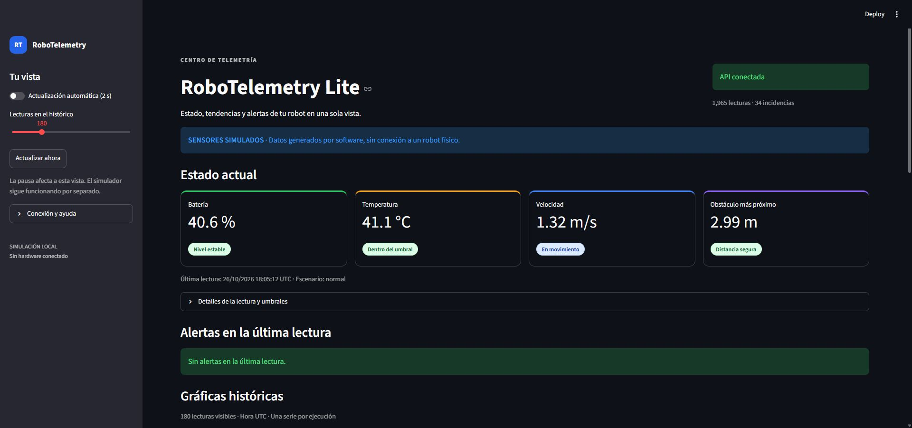
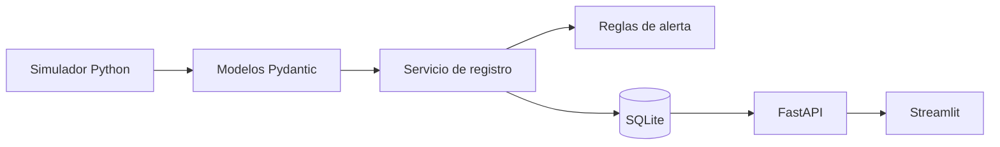
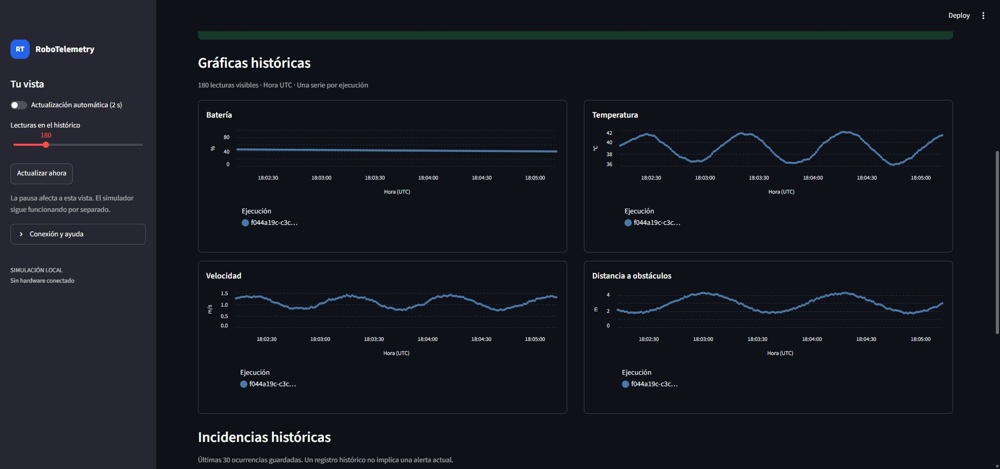

# RoboTelemetry Lite · v1.0.0

Telemetría **simulada** de un robot móvil: generación reproducible en Python, persistencia SQLite, consultas REST con FastAPI y visualización con Streamlit. Un proyecto local de portfolio para explicar el recorrido completo de una lectura, desde su generación hasta su gráfica y sus alertas.

**Los sensores son simulados. No existe conexión con un robot físico, ABB RobotStudio ni AWS.** La aplicación no necesita cuentas externas ni servicios de pago.



Captura real del frontend tomada el 26 de octubre de 2026. [Ver las incidencias y la exportación](docs/assets/dashboard-historico.jpg).

## Qué incluye

- Cuatro magnitudes coherentes: batería, temperatura, velocidad y distancia al obstáculo más próximo.
- Semilla reproducible y cinco escenarios, incluida una demostración con anomalías.
- Mediciones y alertas guardadas juntas en una transacción SQLite.
- API de consulta con validación, paginación, filtros y documentación OpenAPI.
- Dashboard con estado actual, alertas de la última lectura, histórico, cuatro gráficas UTC, tabla y CSV.
- Pruebas unitarias, de API e interfaz, y comprobación completa con procesos locales reales.

## Arquitectura y tecnologías



El simulador escribe en SQLite mediante el servicio. La API consulta esa misma base. El dashboard consume únicamente la API por HTTP: refrescar o cerrar la interfaz no inicia una simulación ni elimina datos. Los tres procesos se arrancan por separado.

| Tecnología | Función |
| --- | --- |
| Python 3.12+ | Generación, reglas, coordinación y herramientas de consola. |
| Pydantic | Contratos, rangos, números finitos y fechas con zona horaria. |
| SQLite, biblioteca estándar | Persistencia, claves foráneas, restricciones, índices y transacciones. |
| FastAPI y Uvicorn | API REST y servidor local. |
| Streamlit y pandas | Interfaz, datos históricos y exportación. |
| httpx | Cliente HTTP del dashboard y comprobaciones de integración. |
| pytest y pytest-cov | Pruebas y cobertura de sentencias y ramas. |
| GitHub Actions | Workflow para Windows y Ubuntu con Python 3.12 y 3.14. |

Las dependencias y sus rangos están en [pyproject.toml](pyproject.toml). El extra `dev` incluye `httpx2`, usado por el cliente de pruebas de Starlette; el cliente de la aplicación usa `httpx`. No hay un bloqueo de todas las dependencias transitivas.

## Instalación en Windows PowerShell

Necesitas Python **3.12 o superior** con el lanzador `py`, y conexión a Internet para instalar dependencias. SQLite viene incluido en Python. Abre la carpeta del proyecto en VS Code y utiliza una terminal situada en su raíz, donde se encuentra este README:

```powershell
py --list
py -3.12 -m venv .venv
.\.venv\Scripts\python.exe --version
.\.venv\Scripts\python.exe -m pip install --upgrade pip
.\.venv\Scripts\python.exe -m pip install -e '.[dev]'
.\.venv\Scripts\python.exe -m pip check
```

Si tienes Python 3.14 en lugar de 3.12, sustituye únicamente la creación del entorno por `py -3.14 -m venv .venv`. El resto de comandos es idéntico. No necesitas activar el entorno ni cambiar `ExecutionPolicy`.

## Primera demostración, sin tocar otros datos

Desde la raíz del proyecto:

```powershell
.\.venv\Scripts\python.exe scripts\prepare_demo.py --output data/demo-v1.sqlite3 --seed 42
```

Este comando crea **un archivo nuevo** con 140 lecturas: 60 del escenario `normal` y 80 de `demo`, en dos ejecuciones distintas. Con la semilla 42 y los umbrales predeterminados produce 34 incidencias: 17 de temperatura, 5 de batería y 12 de obstáculos. Los valores se repiten; las fechas UTC y los identificadores de ejecución cambian.

La herramienta exige `--output` y rechaza archivos ya existentes, incluidos los auxiliares SQLite. No borra, reutiliza ni sobrescribe bases. Si `data/demo-v1.sqlite3` existe, elige otro nombre y utiliza ese mismo nombre en las terminales siguientes. La demo usa explícitamente los umbrales 20 %, 65 °C y 0,5 m; no lee `ROBO_DB_PATH` ni umbrales del entorno.

### Terminal 1: API

Abre una terminal PowerShell en la raíz del proyecto:

```powershell
$env:ROBO_DB_PATH = 'data/demo-v1.sqlite3'
$env:ROBO_BATTERY_LOW_PCT = '20'
$env:ROBO_TEMPERATURE_HIGH_C = '65'
$env:ROBO_OBSTACLE_NEAR_M = '0.5'
.\.venv\Scripts\python.exe -m uvicorn robotelemetry.api:app --host 127.0.0.1 --port 8000
```

La documentación interactiva está en [http://127.0.0.1:8000/docs](http://127.0.0.1:8000/docs). Deja esta terminal abierta.

### Terminal 2: dashboard

En otra terminal, también desde la raíz:

```powershell
$env:ROBO_API_URL = 'http://127.0.0.1:8000'
.\.venv\Scripts\python.exe -m streamlit run dashboard.py --server.address 127.0.0.1 --server.port 8501 --browser.gatherUsageStats false
```

Abre [http://127.0.0.1:8501](http://127.0.0.1:8501). Con solo los datos de la demo verás 140 lecturas y 34 incidencias. El aviso de antigüedad es normal: la generación del lote ya terminó. La pausa de la actualización afecta únicamente a la vista.



Captura real del 26 de octubre de 2026, anterior al ajuste del eje de varios días; no valida ese nuevo formato. Las ventanas de al menos 24 horas incluyen fecha y hora UTC para distinguir los ticks diarios; las ventanas cortas muestran la hora UTC. La comprobación automatizada de esa distinción está documentada en [VERIFICACION.md](docs/VERIFICACION.md); la revisión visual final de ventanas de varios días sigue pendiente.

### Terminal 3: simulación en directo

Puedes comprobar primero los recuentos iniciales desde una tercera terminal:

```powershell
Invoke-RestMethod 'http://127.0.0.1:8000/health'
Invoke-RestMethod 'http://127.0.0.1:8000/config'
Invoke-RestMethod 'http://127.0.0.1:8000/telemetry/latest'
```

Después, desde esa misma terminal situada en la raíz, añade una ejecución normal en directo:

```powershell
$env:ROBO_DB_PATH = 'data/demo-v1.sqlite3'
$env:ROBO_BATTERY_LOW_PCT = '20'
$env:ROBO_TEMPERATURE_HIGH_C = '65'
$env:ROBO_OBSTACLE_NEAR_M = '0.5'
.\.venv\Scripts\python.exe -m robotelemetry.simulator --seed 42 --scenario normal
```

Se añade una lectura por segundo hasta `Ctrl+C`. La última lectura normal puede no tener alertas actuales aunque el histórico conserve las 34 incidencias de la demo. Para ver anomalías en directo, detén el simulador y repite el comando con `--scenario demo`.

Detén cada proceso con `Ctrl+C` en su terminal. Reiniciar la API o el dashboard conserva las mediciones. Reiniciar el simulador crea otra ejecución y añade lecturas; no reanuda la ejecución anterior. Si un puerto ya está ocupado, detén tu proceso anterior o utiliza puertos libres, ajustando `ROBO_API_URL` al puerto de la API.

El recorrido ampliado está en [docs/DEMO.md](docs/DEMO.md).

## Simulación, fechas y alertas

| Escenario | Comportamiento |
| --- | --- |
| `normal` | Evolución habitual de las cuatro magnitudes. |
| `low_battery` | Descenso acelerado de batería. |
| `overheating` | Aumento de temperatura. |
| `obstacle` | Aproximación a un obstáculo y reducción de velocidad. |
| `demo` | Ciclo de condiciones normales y anomalías. |

```powershell
# Veinte lecturas, intervalo real predeterminado de un segundo.
.\.venv\Scripts\python.exe -m robotelemetry.simulator --seed 42 --scenario obstacle --samples 20

# Adquisición acelerada con hora UTC real, sin fechas futuras artificiales.
.\.venv\Scripts\python.exe -m robotelemetry.simulator --seed 42 --scenario normal --samples 20 --interval 0.1

# Historial sintético finito, sin esperas entre lecturas.
.\.venv\Scripts\python.exe -m robotelemetry.simulator --seed 42 --scenario demo --samples 80 --interval 0

.\.venv\Scripts\python.exe -m robotelemetry.simulator --help
```

Estos comandos escriben en la base que indique `ROBO_DB_PATH` de esa terminal. Si no está definida, utilizan `data/robotelemetry.sqlite3`.

La semilla y el escenario reproducen los valores. Cada ejecución tiene otro `run_id`; `sequence` comienza en 1. El modelo avanza un segundo lógico por paso: `t_sim = sequence - 1`. Con intervalo mayor que cero, el `timestamp` es la adquisición UTC real; el intervalo controla la espera, no el paso lógico. El ritmo depende del sistema y no constituye una garantía de tiempo real.

Con `--interval 0` es obligatorio indicar `--samples`: se guarda un historial sintético de pasos de un segundo que termina al inicio de la ejecución. Sus fechas representan tiempo simulado. El dashboard normaliza fechas ISO 8601 de distintas precisiones y zonas a UTC, y avisa de datos antiguos o futuros. No reescribe fechas presentes en bases anteriores.

Una alerta es una **ocurrencia por lectura y regla incumplida**: batería ≤ umbral, temperatura ≥ umbral u obstáculo ≤ umbral. Pueden generarse hasta tres por lectura. Una condición mantenida genera nuevas ocurrencias en cada medición; no hay apertura, cierre, reconocimiento ni deduplicación de incidentes. El histórico puede acumular más incidencias que lecturas sin que exista una inconsistencia.

## Configuración y persistencia

| Variable | Valor predeterminado | Significado |
| --- | --- | --- |
| `ROBO_DB_PATH` | `data/robotelemetry.sqlite3` | Archivo SQLite. Las rutas relativas se anclan a la raíz del proyecto. |
| `ROBO_BATTERY_LOW_PCT` | `20` | Alerta de batería ≤ porcentaje; rango 0–100. |
| `ROBO_TEMPERATURE_HIGH_C` | `65` | Alerta de temperatura ≥ °C; rango −20–150. |
| `ROBO_OBSTACLE_NEAR_M` | `0.5` | Alerta de distancia ≤ metros; rango 0–20. |
| `ROBO_API_URL` | `http://127.0.0.1:8000` | API consultada por Streamlit. |

Las variables se leen al arrancar cada proceso. Una asignación en PowerShell no se propaga a otras terminales ya abiertas. Configura **la misma base y umbrales en API y simulador**. Al cambiarlos, reinicia ambos: los nuevos umbrales afectan a futuras lecturas y no recalculan las alertas guardadas. Los archivos `.env` no se cargan automáticamente.

SQLite crea el archivo si no existe y conserva los datos al reiniciar. Cada medición guarda ejecución, secuencia, semilla, escenario, fecha y magnitudes. Las alertas referencian su medición. El almacenamiento utiliza SQL parametrizado, restricciones, claves foráneas, índices y modo WAL; medición y alertas se confirman juntas o se revierten juntas.

La interfaz consulta una ventana de 60 a 1000 lecturas y las 30 incidencias más recientes. La tabla y el CSV contienen **la ventana de mediciones visible**, no toda la base. Las gráficas separan las ejecuciones mediante colores y leyenda.

## API REST

| Método y ruta | Respuesta |
| --- | --- |
| `GET /health` | Estado de consulta de SQLite y contadores. No comprueba que el simulador esté activo. |
| `GET /config` | Umbrales cargados por la API. |
| `GET /telemetry/latest` | Última lectura por fecha e ID; `404` si no hay datos. |
| `GET /telemetry/history` | Historial con `limit`, `offset`, `since` y `until`. |
| `GET /alerts` | Incidencias con `limit`, `offset` y `kind`. |
| `GET /docs` | Documentación interactiva OpenAPI. |

El historial se ordena por fecha e identificador descendentes. Los límites temporales son inclusivos. `limit` admite 1–1000 y `offset` 0–9223372036854775807. `since` y `until` requieren zona horaria, deben poder representarse en UTC entre los años 1 y 9999 y cumplir `since ≤ until`. Los parámetros inválidos reciben `422`, incluidos offsets excesivos y fechas extremas cuyo desplazamiento UTC desbordaría el rango. Los errores SQLite reciben `503` con un mensaje público controlado.

```powershell
Invoke-RestMethod 'http://127.0.0.1:8000/telemetry/history?limit=10&offset=0'
Invoke-RestMethod 'http://127.0.0.1:8000/alerts?kind=near_obstacle&limit=10'

# Ejemplo de filtro: ajusta las fechas al historial que quieras consultar.
Invoke-RestMethod 'http://127.0.0.1:8000/telemetry/history?since=2026-10-31T00:00:00Z&until=2026-10-31T23:59:59Z'
```

`kind` admite `low_battery`, `high_temperature` y `near_obstacle`. La API es de consulta; la escritura corresponde al proceso simulador a través del servicio.

## Pruebas y verificación

```powershell
.\.venv\Scripts\python.exe -m pytest --cov=robotelemetry --cov-report=term-missing
.\.venv\Scripts\python.exe scripts\smoke_check.py
.\.venv\Scripts\python.exe -m pip check
```

La suite prueba simulador, validación, reglas, persistencia, endpoints, dashboard y protección de datos de la herramienta de demo. Incluye regresiones de paginación, adquisición acelerada, fechas ISO mixtas, normalización de fechas extremas y ejes UTC en ventanas cortas y de varios días. Las pruebas utilizan bases temporales y dobles HTTP donde procede.

`smoke_check.py` utiliza SQLite temporal y puertos libres: ejecuta la CLI, arranca FastAPI y Streamlit, consulta HTTP, reinicia la API para comprobar persistencia y ejecuta el dashboard con AppTest contra la API real. Comprueba cuatro métricas y cuatro gráficas; después detiene sus propios procesos. El HTTP de Streamlit verifica el arranque del servidor; AppTest verifica la ejecución de la interfaz. **No sustituye una inspección visual de navegador.**

Los resultados realmente ejecutados, la cobertura y el estado de la instalación limpia están en [docs/VERIFICACION.md](docs/VERIFICACION.md). Ese documento distingue evidencia local, comprobación visual anterior y revisiones pendientes; no atribuye resultados locales a GitHub Actions.

El [workflow](.github/workflows/tests.yml) instala el proyecto, ejecuta `pip check`, pytest con cobertura y el smoke check en Windows y Ubuntu, con Python 3.12 y 3.14. Se ha revisado localmente con actionlint; la matriz **no se ha ejecutado en GitHub**. Consulta el estado exacto en el informe de verificación.

## Organización del código

| Archivo o directorio | Responsabilidad |
| --- | --- |
| `src/robotelemetry/config.py` | Rutas, configuración de entorno y umbrales. |
| `models.py` | Contratos Pydantic de mediciones, escenarios y alertas. |
| `simulator.py` | Generador con estado y semilla; reloj lógico y ejecución CLI. |
| `alerts.py` | Reglas puras de detección. |
| `service.py` | Coordinar evaluación y registro de cada lectura. |
| `storage.py` | Tablas, transacciones y consultas parametrizadas SQLite. |
| `api.py` | Endpoints de consulta, validación HTTP y errores públicos. |
| `dashboard.py` | Cliente HTTP y presentación Streamlit. |
| `dashboard_styles.py` | Estilos del frontend sin recursos externos. |
| `__init__.py` | Versión del paquete. |
| `dashboard.py` en la raíz | Entrada de Streamlit. |
| `scripts/prepare_demo.py` | Crear una demostración en una base nueva, sin sobrescribir. |
| `scripts/smoke_check.py` | Comprobar integración con procesos y HTTP reales. |
| `tests/` | Pruebas aisladas del histórico local. |
| `docs/` | Demo, resultados, capturas y presentación del portfolio. |

## Limitaciones y publicación

- Es un modelo didáctico, sin calibración física ni control de un robot. Una ejecución larga puede agotar la batería; no existe recarga automática.
- La aplicación está diseñada para localhost, sin autenticación ni autorización. No se debe exponer como servicio público sin trabajo adicional.
- SQLite es adecuado para el MVP local. No se ha validado carga sostenida, ingestión distribuida ni tolerancia a fallos de producción.
- No hay retención, migraciones ni copias de seguridad automáticas; el histórico crece mientras se genera telemetría.
- `/health` no acredita la salud del productor. La interfaz muestra la antigüedad de las lecturas.
- Las consultas HTTP que componen cada refresco no comparten una transacción de snapshot; con generación en curso puede haber pequeñas diferencias temporales entre contadores, última lectura e histórico.
- La revisión visual final de ejes de varios días quedó pendiente por indisponibilidad del navegador de automatización. La especificación y los datos de las cuatro gráficas sí disponen de regresiones automatizadas.
- No se ha ejecutado la matriz remota de GitHub Actions ni una auditoría específica de vulnerabilidades de dependencias. Las versiones comprobadas localmente constan en el informe de verificación.

`.gitignore` excluye bases SQLite y auxiliares, `data/`, entornos virtuales, resultados de prueba, temporales y configuración sensible habitual. No es un detector de secretos: revisa siempre los archivos que vayas a añadir. Las capturas incluidas proceden de datos simulados de demostración; **no se distribuyen bases de datos ni históricos locales**.

La versión del código es **1.0.0**, preparada localmente; no se ha publicado un repositorio, una etiqueta ni una release. Cambios en [CHANGELOG.md](CHANGELOG.md). Para presentar el proyecto con afirmaciones verificables, consulta [docs/PORTFOLIO.md](docs/PORTFOLIO.md).
